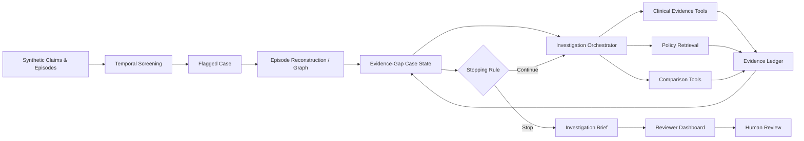

# EPISIGHT Prototype — Project Context & Development Plan

> Source of truth for the prototype implementation. This document consolidates the refined EPISIGHT proposal into an engineering plan. The prototype scope is intentionally limited to synthetic data and a demonstrable investigation workflow. It is **not** a production BPJS system and must not imply production integration.

---

## 1. Project Identity

- **Project name:** EPISIGHT
- **Positioning:** Evidence-first investigation copilot for **Episode Integrity**.
- **Primary problem:** A claim or repeated service pattern can look suspicious when viewed in isolation, while the true meaning often depends on the full episode timeline, clinical context, relevant exceptions, and supporting evidence.
- **Prototype focus:**
  - Readmission.
  - Fragmentation / unbundling of episodes.
- **Core principle:**
  - A risk signal starts an investigation.
  - A risk signal is **not** a verdict.
  - No evidence means no forced conclusion.
  - Conflicting or unavailable evidence should trigger explicit uncertainty and/or human review.
- **Human role:**
  - EPISIGHT investigates and structures evidence.
  - Human reviewers retain decision authority.

---

## 2. Product Thesis

- Traditional deterministic rules can identify explicit patterns such as:
  - same patient;
  - same provider/FKRTL;
  - same or related diagnosis;
  - repeated inpatient/outpatient encounter;
  - short temporal interval.
- Those rules do **not** by themselves establish why the repeated episode occurred.
- Legitimate explanations may exist, such as:
  - emergency return;
  - chronic condition;
  - scheduled/staged procedure;
  - follow-up with valid clinical justification.
- EPISIGHT therefore sits **after initial screening** and converts a risk signal into a structured, evidence-grounded investigation.
- The key differentiation is not merely the use of an LLM. The prototype must visibly demonstrate:
  - episode reconstruction;
  - evidence-gap state;
  - adaptive next-step selection;
  - dual-evidence search;
  - explicit stopping logic;
  - evidence provenance;
  - human decision gate.

---

## 3. Core Prototype Workflow

- **Step 1 — Detect**
  - Run deterministic temporal screening.
  - Identify candidate readmission or fragmentation patterns.
  - Create a flagged case.
- **Step 2 — Reconstruct**
  - Assemble related episodes into one chronological view.
  - Link diagnosis, procedures, provider, notes, and claim metadata.
- **Step 3 — Assess Case State**
  - Determine what is already known.
  - Determine what evidence is missing.
  - Determine what question should be investigated next.
- **Step 4 — Investigate**
  - Select a relevant tool based on the evidence gap.
  - Retrieve clinical or policy evidence.
  - Search both:
    - evidence supporting the risk signal;
    - evidence explaining legitimate context.
- **Step 5 — Update & Stop**
  - Update the case state after every tool action.
  - Stop when:
    - evidence is sufficient;
    - evidence is conflicting;
    - required evidence is unavailable;
    - human review is required;
    - maximum allowed investigation steps are reached.
- **Step 6 — Produce Reviewer Brief**
  - Output a structured investigation brief.
  - Preserve provenance for every material evidence item.
  - Do not issue an autonomous fraud verdict, claim rejection, or payment decision.

---

## 4. Target User Journey

- Reviewer opens **Case Queue**.
- Reviewer selects one flagged case.
- Reviewer inspects **Episode Timeline**.
- Reviewer starts or opens **Investigation Workspace**.
- EPISIGHT displays:
  - known evidence;
  - unresolved evidence gaps;
  - current next action;
  - retrieved evidence;
  - investigation history.
- EPISIGHT reaches a stopping state.
- Reviewer opens **Reviewer Brief**.
- Reviewer can inspect individual evidence sources and provenance.
- Reviewer makes the final human judgement outside the AI's authority boundary.

---

## 5. Required Core Screens

- **Screen 1 — Case Queue**
  - List flagged cases.
  - Filter by readmission / fragmentation.
  - Show signal type, provider, date, interval, and investigation status.
- **Screen 2 — Episode Timeline**
  - Show ordered episodes.
  - Show encounter type, diagnosis, procedure, provider, dates, and interval.
  - Allow the reviewer to inspect related evidence.
- **Screen 3 — Investigation Workspace**
  - Show known evidence.
  - Show missing evidence / unresolved questions.
  - Show next action.
  - Show tool/investigation trail.
  - Show newly surfaced evidence.
- **Screen 4 — Reviewer Brief**
  - Show case summary.
  - Show evidence supporting risk.
  - Show evidence explaining legitimate context.
  - Show policy references.
  - Show remaining uncertainty/evidence gap.
  - Show human-review status.
  - Allow source/provenance inspection.

---

## 6. High-Level Architecture



---

## 7. Recommended Technical Stack

- **Frontend:** Next.js.
- **Backend API:** FastAPI / Python.
- **Database:** PostgreSQL.
- **Episode relationships:** NetworkX or a simple in-memory/domain graph abstraction.
- **Retrieval:** local or approved retrieval/RAG over the prototype's policy and evidence corpus.
- **Evidence storage:** structured PostgreSQL evidence objects.
- **Agent orchestration:** explicit state machine / workflow logic with tool calls.
- **Important architectural rule:**
  - Deterministic logic, retrieval logic, and LLM reasoning must be separable.
  - LLM output must not become an untraceable source of truth.

---

## 8. Primary Data Entities

- `Patient`
  - pseudonymous ID only.
- `Provider`
  - synthetic provider/FKRTL metadata.
- `Episode`
  - patient;
  - provider;
  - encounter type;
  - start/end timestamp;
  - diagnosis;
  - procedures.
- `Claim`
  - synthetic claim metadata associated with an episode.
- `ClinicalNote`
  - synthetic note associated with an episode.
- `PolicyDocument`
  - validated prototype policy corpus.
- `Case`
  - screening signal and related episodes.
- `Evidence`
  - source-backed evidence object surfaced during investigation.
- `InvestigationState`
  - known evidence;
  - missing evidence;
  - unresolved questions;
  - tools called;
  - next action;
  - stopping status.
- `InvestigationBrief`
  - structured output for human review.
- `GroundTruth`
  - benchmark-only labels that are **never visible to the agent**.

---

## 9. Minimal Case State Contract

- `case_id`
- `signal_type`
- `related_episode_ids`
- `known_facts[]`
- `supporting_risk_evidence[]`
- `explaining_context_evidence[]`
- `missing_evidence[]`
- `unresolved_questions[]`
- `tools_called[]`
- `next_action`
- `investigation_step`
- `status`
- `stop_reason`

### Allowed high-level investigation statuses

- `FLAGGED`
- `INVESTIGATING`
- `EVIDENCE_SUFFICIENT`
- `EVIDENCE_CONFLICTING`
- `EVIDENCE_UNAVAILABLE`
- `HUMAN_REVIEW_REQUIRED`
- `BRIEF_READY`

---

## 10. Core Agent Tools

- `get_episode_history()`
- `compare_diagnosis()`
- `compare_procedures()`
- `get_provider_context()`
- `retrieve_clinical_evidence()`
- `retrieve_policy()`
- `find_supporting_evidence()`
- `find_exception_evidence()`

### Tool rules

- Every tool must have a typed input schema.
- Every tool must return structured output.
- Every retrieved evidence object must include source metadata.
- Tool failure must be represented explicitly.
- An LLM must never fabricate a replacement answer for a failed tool.
- The orchestrator must limit maximum investigation steps.

---

## 11. Dual-Evidence Requirement

- Every investigated case should actively consider both directions:
  - **Evidence supporting risk**
    - same/related diagnosis;
    - short interval;
    - repeated encounter;
    - repeated/related procedure;
    - same provider.
  - **Evidence explaining legitimate context**
    - emergency return;
    - chronic condition;
    - scheduled/staged procedure;
    - legitimate follow-up;
    - documented clinical justification.
- The agent should not stop simply because one side has evidence.
- Conflicting evidence should remain visible and should not be arbitrarily collapsed into one answer.

---

## 12. Evidence Provenance Contract

Every evidence object should include as many of the following as applicable:

- `evidence_id`
- `case_id`
- `episode_id`
- `source_type`
- `source_id`
- `source_title`
- `source_excerpt`
- `retrieved_by_tool`
- `retrieval_reason`
- `retrieved_at`
- `policy_version` when relevant
- `relevance_category`
  - supporting risk;
  - explaining context;
  - neutral/background.
- `investigation_step`

### Non-negotiable behavior

- A material statement in the reviewer brief should be traceable back to an evidence/source object.
- “No source” should not silently become “known fact.”

---

## 13. Synthetic Benchmark Strategy

- Prototype uses **synthetic data only**.
- Target benchmark size:
  - initial development: 4 golden cases;
  - minimum useful benchmark: 20+ cases;
  - target if time permits: 20–50 cases.
- Benchmark cases should include:
  - legitimate readmission;
  - potential/unresolved readmission;
  - legitimate fragmentation/follow-up;
  - potential fragmentation;
  - scheduled/staged procedure;
  - chronic-condition revisit;
  - emergency return;
  - missing evidence;
  - conflicting evidence;
  - superficially similar but unrelated episodes.
- Ground truth must be stored separately from agent-accessible data.
- Benchmark should include:
  - hard positives;
  - hard negatives;
  - exception labels;
  - expected evidence gaps;
  - expected final system behavior.

---

## 14. Four Golden Cases

- **Case A — Legitimate Readmission**
  - same/similar diagnosis;
  - short interval;
  - emergency evidence exists;
  - legitimate clinical explanation exists;
  - expected behavior: surface explanatory context.
- **Case B — Potential Fragmentation**
  - repeated outpatient care;
  - short interval;
  - justification absent or incomplete;
  - expected behavior: continue investigation / maintain unresolved risk.
- **Case C — Scheduled Procedure**
  - related procedures;
  - planned interval;
  - scheduled-care note exists;
  - expected behavior: recognize legitimate exception context.
- **Case D — Missing Evidence**
  - risk signal exists;
  - contextual evidence unavailable/incomplete;
  - expected behavior: explicit uncertainty and human review.

---

## 15. Evaluation Metrics

- **Episode Recall**
  - Were the expected related episodes successfully reconstructed?
- **Evidence Retrieval Precision**
  - Of retrieved evidence, how much was actually relevant?
- **Evidence Coverage**
  - Of expected relevant evidence, how much was surfaced?
- **Exception Identification Accuracy**
  - Were legitimate exception contexts recognized correctly?
- **Appropriate Escalation**
  - Did missing/conflicting evidence result in the correct escalation state?
- **Investigation Completion Time**
  - Time from investigation start to brief-ready state.
- **Traceability**
  - Proportion of material brief items with usable source/provenance references.
- Optional diagnostic metrics:
  - tool failure rate;
  - average investigation step count;
  - screening false-positive rate for the synthetic benchmark;
  - regression pass rate.

---

## 16. Governance & Safety Boundaries

- Prototype uses synthetic data.
- Patient identifiers are pseudonymous.
- Do not use real JKN participant data without authorization.
- Agent must not:
  - declare fraud;
  - reject a claim;
  - approve a claim;
  - make a payment decision;
  - alter source records;
  - conceal uncertainty.
- Human reviewer remains the decision authority.
- Missing evidence must remain missing.
- Conflicting evidence must remain visible.
- Policy evidence should be versioned and sourceable.
- Access controls should follow least-privilege principles where implemented.
- Audit/provenance should be preserved for investigation actions.

---

## 17. Team Ownership Model

- **Person 1 — Backend, Agent & Core Intelligence**
  - backend APIs;
  - temporal screening;
  - episode reconstruction;
  - evidence-gap state;
  - agent orchestration;
  - tools;
  - retrieval integration;
  - stopping rules;
  - investigation brief;
  - evidence ledger.
- **Person 2 — Frontend, Product & Reviewer Experience**
  - Next.js application;
  - design system;
  - Case Queue;
  - Episode Timeline;
  - Investigation Workspace;
  - Reviewer Brief;
  - evidence detail/provenance UI;
  - uncertainty/error states;
  - reliable end-to-end product flow.
- **Person 3 — Synthetic Data, Domain, Benchmark, Evaluation & QA**
  - data schema collaboration;
  - synthetic generator;
  - golden cases;
  - ground truth;
  - clinical notes;
  - policy corpus;
  - benchmark expansion;
  - evaluation metrics;
  - regression harness;
  - domain/governance QA.

---

## 18. Interface Contracts Between Owners

### Person 3 → Person 1

- Synthetic datasets.
- Golden cases.
- Ground-truth schema.
- Clinical notes.
- Policy corpus.
- Expected evidence labels.
- Expected case behavior.

### Person 1 → Person 2

- Stable API contract.
- Typed case object.
- Typed episode timeline object.
- Typed evidence object.
- Typed investigation-state object.
- Typed reviewer-brief object.
- Clear status/error enums.

### Person 1 ↔ Person 3

- Screening validation.
- Evaluation runner integration.
- Failure analysis.
- Regression runs.
- Retrieval quality review.

### Person 2 ↔ Person 3

- Domain terminology.
- Case interpretation labels.
- Uncertainty wording.
- Whether UI representation is clinically/domain-appropriate.

---

## 19. Recommended Monorepo Structure

```text
episight/
├── apps/
│   ├── web/                     # Person 2
│   └── api/                     # Person 1
├── packages/
│   ├── agent/                   # Person 1
│   ├── episode-graph/           # Person 1
│   ├── retrieval/               # Person 1
│   └── shared-types/            # Shared contract
├── data/
│   ├── synthetic/               # Person 3
│   ├── policies/                # Person 3
│   └── ground-truth/            # Person 3
├── evaluation/
│   ├── benchmark/               # Person 3
│   ├── metrics/                 # Person 3
│   └── runners/                 # Person 1 + Person 3
├── tests/
│   ├── backend/
│   ├── frontend/
│   └── e2e/
└── docs/
    ├── architecture.md
    ├── api-contract.md
    ├── data-contract.md
    └── benchmark.md
```

---

## 20. Development Phases

### Phase 0 — Contract Lock

- [ ] Lock prototype scope.
- [ ] Lock four core screens.
- [ ] Lock golden cases.
- [ ] Lock data model.
- [ ] Lock API contract.
- [ ] Lock investigation state schema.
- [ ] Lock evidence schema.
- [ ] Lock status enums.
- [ ] Lock benchmark metric definitions.
- [ ] Define definition of done.

### Phase 1 — Foundation

- Person 1:
  - FastAPI skeleton;
  - DB;
  - screening;
  - episode reconstruction.
- Person 2:
  - Next.js skeleton;
  - design system;
  - Case Queue using mock/static contract.
- Person 3:
  - synthetic generator;
  - 4 golden cases;
  - initial ground truth;
  - policy/clinical-note structure.

### Phase 2 — Core Intelligence

- Person 1:
  - case state;
  - agent;
  - tools;
  - retrieval;
  - stopping logic.
- Person 2:
  - Episode Timeline;
  - Investigation Workspace.
- Person 3:
  - realistic synthetic notes;
  - policy corpus;
  - benchmark expansion.

### Phase 3 — Integration

- Person 1:
  - reviewer brief;
  - provenance/evidence ledger;
  - stable API.
- Person 2:
  - connect real backend;
  - Reviewer Brief;
  - evidence drawer;
  - uncertainty/error states.
- Person 3:
  - evaluation runner;
  - metrics;
  - hard negatives and missing/conflicting cases.

### Phase 4 — Validation

- [ ] Run all golden cases end-to-end.
- [ ] Run benchmark.
- [ ] Inspect failures per case.
- [ ] Fix screening/reconstruction defects.
- [ ] Fix retrieval defects.
- [ ] Fix agent decision/stopping defects.
- [ ] Fix misleading UI states.
- [ ] Re-run benchmark.
- [ ] Record regression baseline.

### Phase 5 — Stabilization

- [ ] Error handling complete.
- [ ] Timeouts and max-step limits enforced.
- [ ] Frontend loading/error states stable.
- [ ] Evidence provenance inspectable.
- [ ] Golden cases deterministic.
- [ ] Benchmark reproducible.
- [ ] README setup instructions validated from a clean environment.

---

## 21. Priority Levels

### P0 — Must Exist

- [ ] Synthetic dataset.
- [ ] Readmission/fragmentation screening.
- [ ] Episode reconstruction.
- [ ] Evidence-gap state.
- [ ] Tool-based investigation.
- [ ] Dual-evidence search.
- [ ] Explicit stopping rules.
- [ ] Reviewer brief.
- [ ] Provenance/source links.
- [ ] Four usable web screens.
- [ ] Four golden cases.
- [ ] Human-review state.

### P1 — Strongly Recommended

- [ ] 20+ benchmark cases.
- [ ] Automated evaluation runner.
- [ ] Policy retrieval with version/source metadata.
- [ ] Investigation trail in UI.
- [ ] Regression tests.
- [ ] Explicit missing/conflicting evidence UX.
- [ ] Basic RBAC concept or protected reviewer role if time permits.

### P2 — Stretch Goals

- [ ] 50-case benchmark.
- [ ] Streaming investigation progress.
- [ ] Richer benchmark dashboard.
- [ ] More advanced graph visualization.
- [ ] Reviewer notes/history.
- [ ] More complete audit-event viewer.
- [ ] Deployment hardening beyond prototype needs.

---

## 22. Non-Goals for the Prototype

- Do not build a full BPJS production claims system.
- Do not connect to real participant data.
- Do not simulate payment approval/rejection authority.
- Do not build fraud verdict automation.
- Do not overbuild authentication if it blocks the core investigation flow.
- Do not build multi-agent complexity unless the evidence-gap workflow demonstrably requires it.
- Do not use blockchain or unrelated infrastructure simply for perceived novelty.
- Do not prioritize decorative dashboards over working investigation logic.

---

## 23. Overall Definition of Done

The prototype is considered complete only when all P0 behavior below works end-to-end:

- [ ] A synthetic flagged case can be selected from the Case Queue.
- [ ] Screening logic identifies the relevant risk signal.
- [ ] Related episodes are reconstructed programmatically.
- [ ] The system creates an explicit investigation state.
- [ ] The agent identifies at least one meaningful evidence gap.
- [ ] The agent chooses a tool based on that gap.
- [ ] Evidence supporting risk can be surfaced.
- [ ] Evidence explaining legitimate context can be surfaced.
- [ ] Tool results update case state.
- [ ] Agent stops according to a documented stopping rule.
- [ ] Missing evidence stays explicitly missing.
- [ ] Conflicting evidence can trigger human review.
- [ ] Reviewer Brief is generated from structured backend data.
- [ ] Material evidence can be traced to a source/provenance object.
- [ ] All four golden cases pass their expected behavior checks.
- [ ] Ground truth is inaccessible to the investigation agent.
- [ ] No real JKN participant data is used.
- [ ] No autonomous fraud verdict, claim rejection, or payment decision is exposed.
- [ ] The application can be run reliably from documented setup instructions.

---

## 24. Engineering Principle

- Build the smallest system that **proves the EPISIGHT mechanism**, not the largest system that looks impressive.
- If a feature does not strengthen one of these, question whether it belongs in the MVP:
  - episode understanding;
  - evidence quality;
  - adaptive investigation;
  - uncertainty handling;
  - provenance;
  - reviewer usability;
  - measurable evaluation.
