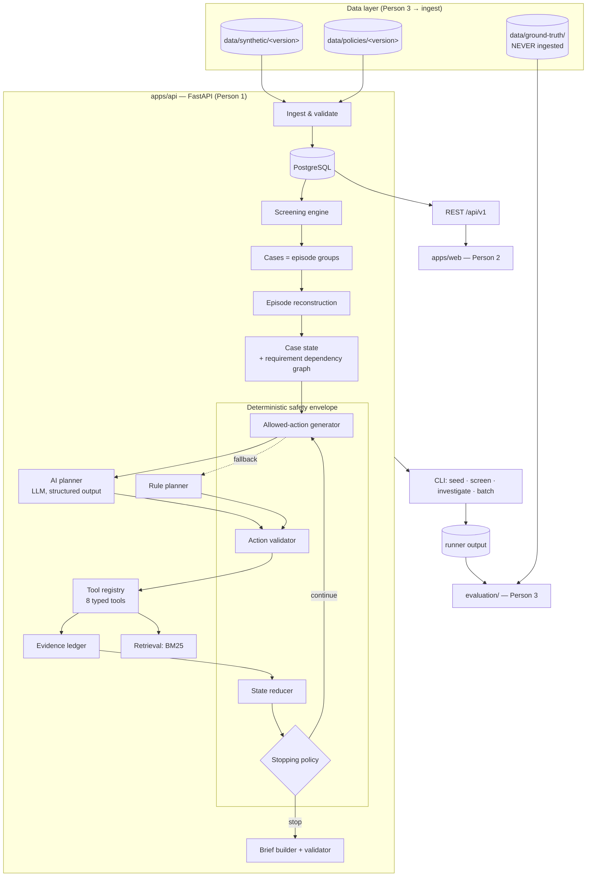
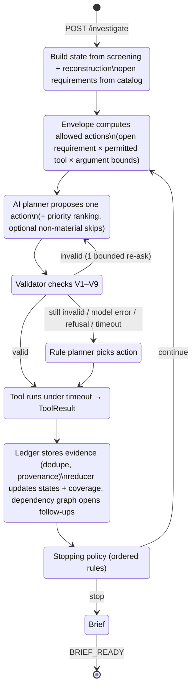

# EPISIGHT — Technical Architecture (Proposal)

> **Status:** **v1.0 ACCEPTED** (2026-10-02). Owned by Person 1. Decisions referenced here are locked in [decisions.md](decisions.md).
> **Date:** 2026-10-01 (v0.2: AI planner made core; decisions moved to [decisions.md](decisions.md))
> **Sources of truth:** [00_EPISIGHT_PROJECT_CONTEXT.md](00_EPISIGHT_PROJECT_CONTEXT.md), [01_PERSON_1_BACKEND_AGENT.md](01_PERSON_1_BACKEND_AGENT.md), [reference/EPISIGHT_Final_Enhanced_Healthkathon_2026.docx](reference/EPISIGHT_Final_Enhanced_Healthkathon_2026.docx).
> **Companion docs:** [decisions.md](decisions.md) · [data-contract.md](data-contract.md) · [api-contract.md](api-contract.md) · [development-plan.md](development-plan.md)

---

## 1. Repository Inspection (as of 2026-10-01)

- One commit (`fe9c9ce`), documentation only. No application code, no dataset, no policy corpus, no CI. Remote: `Episight-Healthkathon/prototype`.
- Local toolchain: Python 3.11 (system) + `uv` 0.12 (can provision 3.12), Node 24 + pnpm 10, Docker 29 + Compose v5, PostgreSQL 17.
- Consequence: every contract below is a proposal, and nothing needs migrating.

## 2. Source Reconciliation — Discrepancies Found

Each row maps to an entry in [decisions.md](decisions.md).

| # | Discrepancy | Where | Resolution |
|---|---|---|---|
| R1 | Golden **Case D** is "Missing Evidence" in the context doc, but the proposal's demo script makes Case D "ambiguous / conflicting". | Context §14 vs proposal §12 | Five golden cases: A–D as in the context doc, plus **E — Conflicting Evidence**. → D-01 |
| R2 | Proposal's benchmark scenarios are lettered A–H with different meanings. | Proposal §9 | Scenario classes are named (e.g., `LEGIT_STAGED_PROCEDURE`); letters are reserved for golden cases. → D-01 |
| R3 | The status list mixes **progress** (`FLAGGED`, `INVESTIGATING`, `BRIEF_READY`) with **outcome** (`EVIDENCE_*`, `HUMAN_REVIEW_REQUIRED`). | Context §9 | Three separate fields: `progress_status`, `outcome`, `stop_reason`. All seven original values are preserved across the first two. → D-04 |
| R4 | Proposal §7 suggests *High / Medium / Low review priority* labels. | Proposal §7 | Deferred; if adopted, deterministic and never a score. → D-06 |
| R5 | Proposal lists "different FKRTL / higher class" as a readmission exception, but screening already requires the same FKRTL. | Proposal §3 | Different-provider pairs are never flagged. A class change within the same provider is surfaced by `get_provider_context()`. → D-02 |
| R6 | Proposal's evidence matrix names `query_episode_graph()` and `get_procedure_context()`. | Proposal §6 | Aliases of `get_episode_history()` / `compare_procedures()`. The tool list stays at the eight in context §10. |
| R7 | Monorepo layout splits Python code into several `packages/*`. | Context §19 | A single Python package with the same module boundaries. → D-10 |

## 3. Architectural Principle

> **Rules control the safety envelope. AI controls adaptive investigation within that envelope.**
> **Rules determine what is valid. The agent determines what is useful next.**

Deterministic code governs screening, episode reconstruction, schema and state integrity, the set of allowed actions, state transitions, and safety-critical stopping conditions. An **AI planner** performs adaptive evidence-gap prioritization and next-tool selection inside that constrained environment. Every AI-proposed action is validated by code before execution, and a deterministic fallback planner remains available.

Supporting rules:

1. **Tool results are the only evidence.** Nothing enters the evidence ledger unless it points at a stored source (record field, note span, or policy section). LLM text, including the planner's note, is never evidence and never appears in the brief.
2. **Missing ≠ negative.** `NOT_FOUND` (searched, absent) and `UNAVAILABLE` (the source should exist but cannot be read) are distinct. Neither ever becomes "legitimate" or "risk confirmed".
3. **State is the product.** The investigation state is persisted after every step. The UI renders structured state and never parses prose or model reasoning.
4. **Ground truth is physically unreachable** by the application (§10). Person 3 owns it.
5. **No decision authority.** No endpoint, enum, or brief field can express fraud / approve / reject / pay.

## 4. System Overview



## 5. Repository Layout

```text
prototype/
├── apps/
│   ├── api/                        # Person 1 — uv-managed Python project
│   │   ├── pyproject.toml
│   │   ├── alembic/
│   │   ├── src/episight/
│   │   │   ├── main.py             # FastAPI app factory, lifespan
│   │   │   ├── config.py           # pydantic-settings
│   │   │   ├── contracts/          # Pydantic enums + DTOs = canonical contract
│   │   │   ├── api/                # routers, error handlers, DTO mappers
│   │   │   ├── db/                 # SQLAlchemy models, session, repositories
│   │   │   ├── ingest/             # dataset + policy corpus loader/validator
│   │   │   ├── screening/          # pure functions
│   │   │   ├── episodes/           # EpisodeGraph + reconstruction   (≙ packages/episode-graph)
│   │   │   ├── retrieval/          # tokenizer, BM25, note/policy retrievers, context matcher (≙ packages/retrieval)
│   │   │   ├── agent/              # requirements, envelope, planners, tools, reducer, stopping, orchestrator (≙ packages/agent)
│   │   │   │   ├── envelope/       # allowed actions, validator, stopping — deterministic
│   │   │   │   └── planners/       # llm_planner.py, rule_planner.py
│   │   │   ├── llm/                # provider adapter, prompt templates, record/replay cache
│   │   │   ├── evidence/           # ledger, dedupe, provenance validation
│   │   │   ├── brief/              # brief builder + guardrail validator
│   │   │   └── cli.py
│   │   └── tests/
│   └── web/                        # Person 2
├── packages/shared-types/          # generated TS types + mock fixtures
├── data/                           # Person 3
├── evaluation/                     # Person 3 (+ runners/ shared)
├── tests/e2e/
├── docker-compose.yml
└── docs/
```

Import rules (enforced by tests in M1):

- `screening`, `episodes`, `agent`, `retrieval`, `brief` do not import `api` or `db`; they receive repositories through interfaces.
- `agent/envelope` does not import `llm`. The safety envelope must work with no model present.
- Nothing under `src/episight/` references `data/ground-truth` or imports `evaluation`.

## 6. Responsibility Split: Deterministic Envelope vs AI Planner

| Concern | Owner | Notes |
|---|---|---|
| Screening (readmission / fragmentation) | **Deterministic** | Never an LLM |
| Episode grouping, reconstruction, intervals | **Deterministic** | |
| Diagnosis / procedure comparison | **Deterministic** | Exact code, ICD-10 category, configured relation tables |
| Requirement catalog + dependency graph (which questions exist, which findings open follow-ups) | **Deterministic** | Versioned config |
| Allowed-action set per step (which tool may address which open requirement, with which argument bounds) | **Deterministic** | §7.3 |
| **Which open gap to pursue next, which tool, and how to scope it** (episodes, note types, query) | **AI planner** | Chooses only from the allowed set |
| **Re-prioritizing gaps after new evidence**; skipping *non-material* questions judged not useful | **AI planner** | Material questions can never be skipped |
| Validating the planner's proposal | **Deterministic** | §7.4 |
| Applying tool results to state, conflict detection | **Deterministic** | |
| Stopping and final outcome | **Deterministic** | The planner may say "nothing more useful"; code decides if stopping is allowed |
| Finding context in notes | Deterministic in P0 (BM25 + lexicon + negation) | LLM passage classifier with verbatim-span validation is P1 (M10) |
| Brief text | **Deterministic templates** | Optional LLM paraphrase is P2 |

## 7. Investigation Engine

### 7.1 Evidence requirements and the dependency graph

An investigation is a set of **requirements**: the questions that must be answered before a brief is useful. This is the proposal's *Evidence Requirements Matrix* as data.

| Requirement key | Direction | RA | FR | Material | Addressed by |
|---|---|---|---|---|---|
| `EPISODE_RELATEDNESS` | risk | ✔ | ✔ | yes | `get_episode_history` |
| `DIAGNOSIS_CONSISTENCY` | risk | ✔ | ✔ | yes | `compare_diagnosis` |
| `PROCEDURE_RELATIONSHIP` | risk | ✔ | ✔ | if procedures present | `compare_procedures` |
| `PROVIDER_CONTEXT` | background | ✔ | ✔ | no | `get_provider_context` |
| `CLINICAL_DOCUMENT_AVAILABILITY` | background | ✔ | ✔ | yes | `retrieve_clinical_evidence` |
| `EMERGENCY_CONTEXT` | context | ✔ | ✔ | yes | `find_exception_evidence`, `retrieve_clinical_evidence` |
| `CHRONIC_CONDITION_CONTEXT` | context | ✔ | ✔ | yes | same |
| `SCHEDULED_PROCEDURE_CONTEXT` | context | ✔ | ✔ | yes | same |
| `SUPPORTING_EXAM_FOLLOWUP_CONTEXT` | context | — | ✔ | yes | same |
| `CLINICAL_JUSTIFICATION` | context | ✔ | ✔ | yes | same |
| `RISK_INDICATORS_IN_NOTES` | risk | ✔ | ✔ | yes | `find_supporting_evidence` |
| `APPLICABLE_POLICY` | policy | ✔ | ✔ | yes | `retrieve_policy` |
| `SCHEDULE_CONSISTENCY` *(spawned)* | context check | ✔ | ✔ | yes | `compare_procedures` |

**Requirement states:** `OPEN` → `FOUND` | `NOT_FOUND` | `CONFLICTING` | `UNAVAILABLE` | `FAILED` | `SKIPPED` (non-material only).

**Coverage rule.** Each requirement tracks its *in-scope sources* (for example all available notes of relevant types across the episode group) and the sources already searched. A requirement can become `NOT_FOUND` only when coverage is complete. A narrow, targeted search that finds nothing leaves the requirement `OPEN`. This lets the planner search where evidence is most likely first, without weakening the "not found" guarantee.

**Deterministic evidence dependency graph.** Findings open follow-up requirements by rule. The planner then decides when to pursue them relative to other gaps.

```text
SCHEDULED_PROCEDURE_CONTEXT = FOUND   ──opens──▶  SCHEDULE_CONSISTENCY   (performed procedure matches plan?)
EPISODE_RELATEDNESS finds 3rd episode ──rescopes─▶ all context requirements (coverage now includes it)
PROCEDURE_RELATIONSHIP finds procedures ──makes material──▶ PROCEDURE_RELATIONSHIP
CLINICAL_DOCUMENT_AVAILABILITY: note UNAVAILABLE ──marks──▶ affected coverage as UNAVAILABLE
```

### 7.2 Loop



Each iteration persists one `InvestigationAction` (including `planner_source` and any validation errors) and a new state snapshot.

### 7.3 Allowed actions (deterministic)

For each step the envelope emits a list of candidate actions:

```text
{ action_id, requirement_key, tool_name,
  scope_bounds: { episode_ids ⊆ case group, note_types ⊆ relevant types, query: free text ≤ 200 chars | null } }
```

A candidate exists only if the requirement is `OPEN`, the tool is permitted to address that requirement, the call would not repeat an identical earlier call (one retry is allowed after `ERROR`/`TIMEOUT`), and step budget remains.

### 7.4 AI planner and validator

**Planner input** (built by code): a static system prompt covering role, safety envelope, requirement semantics, tool descriptions and "no verdicts". Then the current state: requirements with states and coverage, evidence summaries (IDs + excerpts), the trail so far, the allowed actions, and the remaining step budget. Ground truth is never included.

**Planner output** (structured output with a JSON schema generated per step; the `action_id` enum is the allowed set plus `NO_FURTHER_USEFUL_ACTION`):

```json
{
  "action_id": "A3",
  "scope": { "episode_ids": ["EPI-000456"], "note_types": ["TRIAGE"], "query": "datang via IGD sesak memberat" },
  "priority_ranking": ["EMERGENCY_CONTEXT", "SCHEDULED_PROCEDURE_CONTEXT", "CHRONIC_CONDITION_CONTEXT"],
  "skip": [{ "requirement_key": "PROVIDER_CONTEXT", "reason": "Same provider, no class change on either claim" }],
  "planner_note": "Readmission 5 days after discharge; emergency presentation is the most likely explanation, check triage of episode 2 first."
}
```

**Validator checks (deterministic):**

| # | Check |
|---|---|
| V1 | Response parses and matches the schema |
| V2 | `action_id` is in this step's allowed set |
| V3 | Target requirement is still `OPEN` |
| V4 | Tool is permitted for that requirement |
| V5 | `scope` lies within the action's `scope_bounds`, and the tool input validates against the tool's Pydantic model |
| V6 | Not a duplicate of an earlier identical call |
| V7 | Step budget and run timeout not exceeded |
| V8 | `skip` contains only non-material requirements |
| V9 | `NO_FURTHER_USEFUL_ACTION` is accepted only if no *material* requirement is `OPEN`; otherwise it is rejected |

On failure: one re-ask that includes the validator's errors. If it fails again, or on model error, refusal, or timeout, the **rule planner** chooses the step. The trail records `planner_source ∈ {LLM, LLM_RETRY, RULE_FALLBACK, RULE}`.

**`planner_note` handling:** stored and optionally shown in the workspace, labeled "Planner note". It is a declared short output, not hidden reasoning (thinking content is never stored or shown). It is never evidence and never enters the brief. The reviewer-facing `reason` for each action is generated by code from the requirement and scope.

**Rule planner (fallback and CI):** fixed priority order (structural → document inventory → context requirements by signal-specific order → risk indicators → policy), always searching full coverage in one call. Fully deterministic.

**Model and API notes** (D-18): Claude via the Anthropic Python SDK by default; an OpenAI adapter is also available (same prompt, schema and validation). Current models (Claude Opus 5.5 / Sonnet 5.5) reject forced `tool_choice` and sampling parameters such as `temperature`, so the planner uses **structured outputs** (`output_config.format`) for its decision, and effort (`low` for a per-step planner) is the latency and cost control. Refusal (`stop_reason = "refusal"`) is handled as a planner failure and goes to fallback.

### 7.5 Conflict detection (deterministic)

A requirement becomes `CONFLICTING` when the ledger holds both an `AFFIRMS` and a `NEGATES` item for it from source-backed evidence. Examples: a triage note indicating emergency presentation vs a discharge summary stating an elective readmission; a planned procedure differing from the one performed (`SCHEDULE_CONSISTENCY`); structured `admission_type` vs note-level evidence (D-11).

### 7.6 Stopping policy (ordered; first match wins)

| # | Condition | `stop_reason` | `outcome` |
|---|---|---|---|
| S1 | Any material requirement `CONFLICTING` | `CONFLICTING_EVIDENCE` | `EVIDENCE_CONFLICTING` |
| S2 | Run timeout exceeded | `TIMEOUT` | `HUMAN_REVIEW_REQUIRED` |
| S3 | A material requirement `FAILED` | `TOOL_FAILURE` | `HUMAN_REVIEW_REQUIRED` |
| S4 | No material requirement `OPEN`; ≥ 1 material context requirement `UNAVAILABLE` | `REQUIRED_EVIDENCE_UNAVAILABLE` | `EVIDENCE_UNAVAILABLE` |
| S5 | No material requirement `OPEN`; ≥ 1 material context requirement `FOUND` and all of its spawned checks `FOUND` | `SUFFICIENT_EVIDENCE` | `EVIDENCE_SUFFICIENT` |
| S6 | No material requirement `OPEN`; every material context requirement `NOT_FOUND` (or a spawned check unresolved) | `EVIDENCE_PATHS_EXHAUSTED` | `HUMAN_REVIEW_REQUIRED` (unresolved risk) |
| S7 | `investigation_step >= max_steps` | `MAX_STEPS_REACHED` | `HUMAN_REVIEW_REQUIRED` |
| S8 | Material requirements `OPEN` but no allowed action exists | `NO_ACTIONABLE_GAP` | `EVIDENCE_UNAVAILABLE` |

Every brief goes to a human. `outcome` describes the **evidence situation**, never the claim. `EVIDENCE_SUFFICIENT` means "enough evidence to explain the signal for a reviewer to verify", not "legitimate".

### 7.7 Expected golden-case behavior (for Person 3's ground truth)

| Case | Signal | Key data | Expected outcome / stop reason | Distinguishing behavior |
|---|---|---|---|---|
| A — Legitimate readmission | READMISSION | Emergency presentation documented in episode 2 notes; structured `admission_type` null | `EVIDENCE_SUFFICIENT` / `SUFFICIENT_EVIDENCE` | `EMERGENCY_CONTEXT = FOUND` via note retrieval; risk evidence also listed |
| B — Potential fragmentation | FRAGMENTATION | Outpatient notes present, no justification | `HUMAN_REVIEW_REQUIRED` / `EVIDENCE_PATHS_EXHAUSTED` | All context requirements `NOT_FOUND` after full coverage; brief states unresolved risk |
| C — Scheduled procedure | READMISSION or FRAGMENTATION | Procedure-plan note in episode 1, matching procedure in episode 2 | `EVIDENCE_SUFFICIENT` / `SUFFICIENT_EVIDENCE` | Spawns `SCHEDULE_CONSISTENCY` → `FOUND` |
| D — Missing evidence | READMISSION | Episode 2 notes registered but `UNAVAILABLE` | `EVIDENCE_UNAVAILABLE` / `REQUIRED_EVIDENCE_UNAVAILABLE` | Gaps stated explicitly; nothing inferred |
| E — Conflicting | READMISSION | Triage note says emergency; discharge summary says elective | `EVIDENCE_CONFLICTING` / `CONFLICTING_EVIDENCE` | Both sides visible; stop at S1 |

Golden-case assertions are **behavioral** (outcome, stop reason, key requirement states, mandatory evidence surfaced). They do not assert exact trails, because the AI planner may legitimately take different paths.

## 8. Runtime Model

- **Async-in-process.** `POST /cases/{id}/investigate` creates an `investigation_run` (`QUEUED`), starts an `asyncio` task, and returns `202` with `run_id`. The frontend polls `GET /cases/{id}/investigation` (about every 1 s). State is committed after every step.
- **Concurrency guard.** A second start while a run is active returns `409 INVESTIGATION_IN_PROGRESS`. A re-run requires `rerun: true` and creates a new run; old runs are retained.
- **Timeouts.** Per tool 10 s; per planner call 30 s; per run 180 s (`FULL`) / 60 s (rule modes).
- **Batch mode.** The CLI runs the same orchestrator synchronously.

> **Prototype constraint, not the target architecture.** Jobs live in the API process: a restart loses in-flight runs (they are marked `INTERRUPTED` on startup), there is no queue, retry scheduler, or horizontal scaling, and the design assumes a single worker. A pilot would move runs to a durable queue. The run/state/action tables already make that swap local.

## 9. Retrieval Design

- **In-process BM25** (`rank-bm25`) over (a) clinical-note sentences scoped to the case's episode group and (b) policy sections. It is deterministic, has no infrastructure, and suits a small corpus. No vector DB in P0 (D-09).
- Indonesian-aware normalization (D-08): lowercase, punctuation stripping, Indonesian stop-words, an abbreviation map (`IGD`, `RJ`, `RI`, `kontrol`, …), with English/Latin medical terms and codes kept intact.
- The context matcher uses a lexicon and patterns per context type with a negation window ("tidak ada tanda kegawatdaruratan" must not count).
- Every hit returns `{source_id, char_start, char_end, excerpt}`, and the excerpt is always a literal substring of the stored text.
- Policy hits carry `policy_id`, `section`, `version`, `effective_date`, `source_ref`. Retrieval never generates policy text.

## 10. Ground-Truth Isolation

```text
Application data  ──X──  cannot access  ──X──  Ground truth (owner: Person 3)
        │                                              │
        ▼                                              ▼
Investigation results ─────────▶ External evaluator (evaluation/) ◀──┘
```

1. Ground truth lives only in `data/ground-truth/`. Ingest refuses any path under it, and no DB table stores it.
2. Application code has no loader for it. A test asserts that no module under `src/episight/` mentions `ground-truth`/`ground_truth` or imports `evaluation`.
3. The dataset validator rejects label-like fields (`scenario`, `label`, `expected_*`, …) and scans note text for leaked labels.
4. The planner prompt is built only from application data, so ground truth cannot reach the LLM.
5. Evaluation joins runner output with ground truth outside the backend, keyed by `anchor_episode_ids`.
6. **Person 3 owns and authors ground truth**, so the agent developer does not unintentionally teach the agent the benchmark answers.

## 11. Ablation Support (proposal §13)

| Mode | Behavior | Purpose |
|---|---|---|
| `RULES_ONLY` | Screening + reconstruction + structural comparisons; no retrieval | Baseline |
| `RULES_RETRIEVAL` | Every retrieval tool once, full coverage, fixed order; no dependency graph, no adaptive stopping | Value of retrieval alone |
| `FULL_RULE_PLANNER` | Full envelope + dependency graph + stopping, with the deterministic rule planner | Diagnostic; also the CI mode with no API key |
| `FULL` (default) | Full envelope + **AI planner** | Full EPISIGHT |

How the results should be read:

- If `FULL` does not beat `RULES_RETRIEVAL` on evidence quality or investigation effort, agent complexity is cut (proposal §13).
- If `FULL` ≈ `FULL_RULE_PLANNER`, report honestly that the AI planner adds little over a structured workflow.
- The metrics where the AI planner is expected to help are steps and time to brief, retrieval precision (targeted searches), and coverage under a tight step budget.

## 12. Determinism and Regression

- Current Claude models do not accept sampling parameters, so live `FULL` runs are **not** bit-for-bit reproducible.
- **Record/replay:** every planner request/response is stored keyed by `hash(model, prompt_version, request payload)`. Regression runs replay recorded responses, so planner behavior is reproducible and costs nothing. A cache miss in replay mode fails loudly.
- CI runs `FULL_RULE_PLANNER` (no key needed) plus `FULL` in replay mode.
- Golden assertions are behavioral (§7.7). Person 3's benchmark runs `FULL` live, repeated, to report variance.

## 13. Risks

| Risk | Impact | Mitigation |
|---|---|---|
| The AI planner adds no measurable value over the rule planner | Weakens the "agentic" claim | Ablation includes `FULL_RULE_PLANNER`; coverage rule rewards targeted search; report the result honestly |
| Planner proposes invalid or unsafe actions | Safety | Envelope V1–V9, bounded re-ask, rule fallback; the envelope has no dependency on `llm` |
| LLM non-determinism | Flaky regression | Record/replay; behavioral assertions; deterministic CI mode |
| API outage, rate limits, or no key during the demo | Demo failure | Automatic rule fallback per step; replayed golden runs for the demo; `planner_source` visible |
| Synthetic notes are keyword-trivial | Meaningless retrieval metrics | Person 3 varies phrasing, negations and distractors |
| Contract churn between P1 and P2 | Frontend rework | Pydantic → OpenAPI → generated TS types; fixtures regenerated from models |
| Ground-truth leakage | Invalid benchmark | §10 controls + automated test |
| Policy text inaccuracy | Credibility | Only Person 3's curated corpus is indexed; the backend never generates policy text |
| Overfitting to golden cases | Demo-only system | 20+ case benchmark with hard negatives before tuning is declared done |

## 14. Dependencies (backend)

| Purpose | Package | Notes |
|---|---|---|
| Runtime | Python 3.12, `uv` | lockfile committed |
| API | `fastapi`, `uvicorn[standard]`, `pydantic` v2, `pydantic-settings` | |
| DB | `sqlalchemy` 2.x, `alembic`, `psycopg[binary]` 3 | PostgreSQL 16 in Docker |
| CLI | `typer` | |
| Retrieval | `rank-bm25` | |
| LLM | `anthropic` (official Python SDK) | Key via `ANTHROPIC_API_KEY` env only; never committed |
| Graph | none in P0 (domain class) | |
| Logging | stdlib `logging` + JSON formatter | request_id / run_id correlation |
| Tests | `pytest`, `httpx`, `pytest-cov` | |
| Quality | `ruff`, `mypy` (non-blocking initially) | |
| Contract export | `openapi-typescript` (Node) | generated TS types, committed |

No agent framework (LangChain, LangGraph, etc.). The orchestration loop is an explicit state machine that we own, because the provenance chain must stay inspectable. No model training or fine-tuning (D-19).
